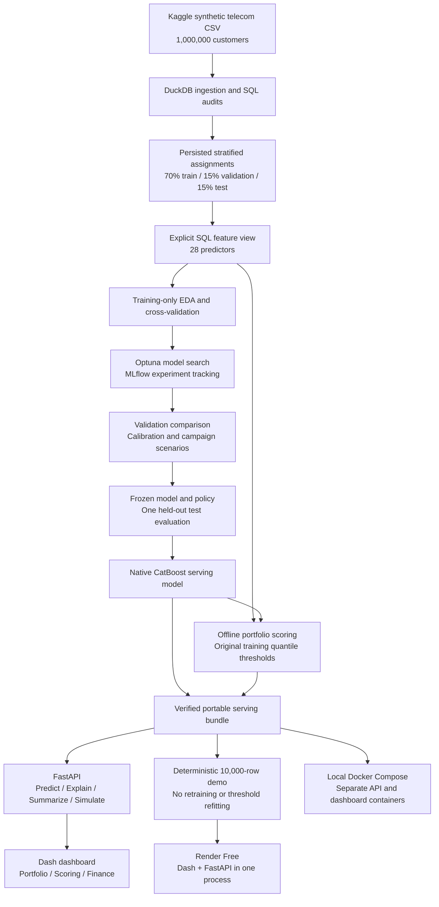

# Customer Churn & Revenue-at-Risk Engine

An end-to-end machine-learning and analytics project that connects **churn prediction, customer-level explanations, portfolio exposure, and capacity-constrained retention economics**.

Built around a one-million-customer synthetic telecom dataset, the project covers validated ingestion, exploratory analysis, reproducible model selection, frozen evaluation, portable inference, a FastAPI backend, and a three-tab Dash dashboard.

**[Open the live demo](https://churn-engine-demo.onrender.com/)**

> The public demo uses **10,000 sampled synthetic customers**, not the full million-row portfolio. It retains the same trained model and original training-derived segmentation thresholds. Render's free service may take about a minute to wake after inactivity.
>
> This is a portfolio demonstration, not an operational retention system. Predicted risk is not a causal treatment effect, and simulated returns are assumptions rather than measured campaign outcomes. Do not enter real personal information.

## Contents

- [The business problem](#the-business-problem)
- [What the application does](#what-the-application-does)
- [Architecture](#architecture)
- [Technology stack](#technology-stack)
- [Dataset and data quality](#dataset-and-data-quality)
- [EDA findings](#eda-findings)
- [Model development and evaluation](#model-development-and-evaluation)
- [From churn risk to campaign value](#from-churn-risk-to-campaign-value)
- [Portfolio segmentation and explainability](#portfolio-segmentation-and-explainability)
- [Financial and statistical calculations explained](#financial-and-statistical-calculations-explained)
- [Run locally](#run-locally)
- [API overview](#api-overview)
- [Reproducibility and testing](#reproducibility-and-testing)
- [Repository structure](#repository-structure)
- [Limitations and next steps](#limitations-and-next-steps)

## The business problem

A retention team usually has more potentially at-risk customers than it can contact. A churn classifier alone leaves several business questions unanswered:

1. **Who is most likely to leave?**
2. **How much monthly-charge exposure is associated with that risk?**
3. **Which customers offer the highest expected net value under a particular retention scenario?**
4. **How do contact cost, retention assumptions, and capacity change the recommended audience?**
5. **Which model inputs are pushing an individual prediction up or down?**

The highest-risk customer is not necessarily the most valuable retention opportunity. A customer with moderate risk and higher charges can have greater expected retained contribution than a higher-risk, lower-charge customer.

This project therefore separates three concepts:

| Concept | Meaning in this project |
|---|---|
| Predicted churn probability | The model's estimate of the dataset's churn label; no established forecast horizon |
| Risk-weighted monthly charges | Sum of `churn_probability * monthlycharges`; an exposure proxy |
| Expected campaign net value | Assumption-based retained contribution minus contact cost |

Neither monthly-charge exposure nor simulated net value is verified MRR, lifetime value, realized loss, or measured uplift.

## What the application does

### 1. Portfolio Overview

- Customer counts, monthly-charge totals, mean predicted churn, and risk-weighted charges.
- A **4 x 3 revenue/risk matrix** with selectable heatmap metrics.
- Filters for source partition, revenue band, risk band, contract, payment method, and internet service.
- All 12 matrix cells remain present, including empty cells.
- Empty results distinguish zero totals from undefined averages and shares.

The portfolio is a descriptive scored snapshot. Its training-customer predictions are in-sample, and its membership does not establish that customers are currently active.

### 2. Customer Scoring

- A form covering the customer identifier and all 28 predictors.
- Dropdowns for dataset categories and binary service/billing flags.
- An illustrative profile for exploring the workflow.
- Churn probability, a local SHAP waterfall, and all feature contributions.
- Editing the profile clears stale results until the user explicitly scores again.

Scoring and explanations come from the same API operation. The interface does not silently combine results from different customer requests.

### 3. Financial Simulator

- Adjustable contact cost, gross margin, retained months, prevention probability, and contact capacity.
- Separate results for the global campaign population and the displayed subset.
- Eligibility and selection counts, expected contribution, cost, net value, and scenario ROI.
- A revenue/risk heatmap and table showing where selected value is concentrated.

**Display filters do not reallocate the campaign.** Selection happens across the entire loaded snapshot first; filters only reveal a subset of that selection. On the public demo, the entire population is the 10,000-customer sample.

## Architecture



### Offline development versus online serving

**Offline:** ingest and validate data, establish splits, explore training data, tune models, compare validation results, freeze the selected setup, evaluate once, and generate serving artifacts.

**Online:** load a trusted bundle, validate requests, score entered profiles, compute native explanations, query the portfolio, and simulate campaign scenarios. There is no model fitting during a request.

The portable bundle removes the serving dependency on the local MLflow database. It contains:

```text
bundle/
|-- manifest.json
|-- model.cbm
`-- portfolio/
    |-- customers.parquet
    |-- thresholds.json
    `-- manifest.json
```

Model provenance, feature order, categorical feature definitions, and artifact checksums are verified on loading. Export also checks prediction and explanation parity. MLflow run IDs remain audit metadata; the serving loader does not resolve them against a tracking server.

## Technology stack

| Layer | Tools | Role |
|---|---|---|
| Environment and dependencies | Python 3.12, uv, `uv.lock` | Locked environments and reproducible installs |
| Analytical storage and querying | DuckDB, SQL, Parquet | Ingestion checks, feature views, snapshots, and aggregations |
| Data transformation | pandas, NumPy | Modeling inputs, validation, and scenario calculations |
| Baselines and preprocessing | scikit-learn | Logistic regression, histogram boosting, random forest, pipelines, metrics |
| Boosted models | CatBoost, XGBoost, LightGBM | Candidate comparison; CatBoost is the serving model |
| Hyperparameter search | Optuna | Separate studies and bounded searches per model |
| Experiment tracking | MLflow with local SQLite/artifacts | Parameters, metrics, provenance, comparisons, and frozen manifests |
| Explainability | Native CatBoost Tree SHAP | Local and offline global explanations without a separate SHAP dependency |
| Backend | FastAPI, Pydantic, Uvicorn | Typed inference and analytics endpoints |
| Frontend | Dash, Plotly, HTTPX | Interactive dashboard and validated API communication |
| WSGI/ASGI bridge | a2wsgi | Serve Dash alongside, or separately from, FastAPI |
| Local deployment | Docker, Docker Compose | Linux containers with a read-only serving bundle |
| Public demo | Render Free | Single-process deployment using a smaller snapshot |
| Testing and CI | pytest, GitHub Actions | Synthetic regressions, bundle integrity, Docker build and smoke checks |

Training and serving have different dependency needs. The `serving` dependency group excludes MLflow and the training-only search libraries; the normal development environment retains them.

## Dataset and data quality

Source: [Customer Churn Prediction Dataset - 1M on Kaggle](https://www.kaggle.com/datasets/isandeep06/customer-churn-prediction-dataset-1m).

The downloaded file contains **1,000,000 rows and 32 columns**, including the customer identifier and churn target. It is synthetic, not a real telecom customer history.

The first analysis step was to verify the actual file rather than assume the dataset description was correct.

| Check | Finding | Project decision |
|---|---|---|
| Target prevalence | Observed churn is **9.9227%**, not the documented 20-25% | Use measured prevalence for baselines and interpretation |
| Identifiers | Customer IDs are unique and nonmissing | Preserve ID alignment through splits, scoring, and exports |
| Contract distribution | Approximately 55.05% one-year, 42.95% two-year, 2.00% monthly | Report both group rates and population size |
| Senior-citizen flag | **254,538 rows (25.45%)** disagree with the documented age-based definition | Exclude the inconsistent flag from predictors |
| Signup date and tenure | Implied endpoints extend into 2032 despite signup dates ending around January 2026 | Exclude signup date; do not invent a coherent longitudinal timeline |
| Billing approximation | **157,229 rows (15.72%)** fall outside the documented +/-10% relationship to charges times tenure | Retain values rather than silently overwrite them |
| Monthly-charge tail | **979 rows** exceed 200; maximum approximately 854.96 | Preserve the tail; do not automatically cap it |
| Service count | **87.99%** differ from the sum of eight service flags | Retain both: the counting definition is unclear |

The ingestion layer checks exact headers, declared types, required values, unique nonblank IDs, valid binary flags, and finite nonnegative numeric values.

### Missingness

Five numerical columns permit missing values:

| Feature | Approximate missing share |
|---|---:|
| Average monthly data usage | 5.00% |
| Credit score | 4.04% |
| Annual income | 3.00% |
| Number of complaints | 2.99% |
| Customer satisfaction | 1.99% |

About **15.92% of customers** have at least one missing value across these columns. Dropping every incomplete row would discard a substantial part of the portfolio.

Missing complaints are not treated as zero complaints. The final CatBoost pipeline handles numeric missing values natively. Similar observed churn rates between missing and nonmissing groups do **not** establish a missing-at-random mechanism.

## EDA findings

Initial schema and consistency checks used the source file. Subsequent target-driven EDA used the **700,000 training customers**, leaving validation for comparison and test for the frozen final evaluation.

Detailed exploration is retained in [the EDA notebook](experiments/01_eda_exploration.ipynb).

### Contract type was one of the clearest associations

| Contract | Training customers | Observed churn | Lift versus training baseline |
|---|---:|---:|---:|
| Month-to-month | 13,904 | 26.44% | 2.66x |
| One-year | 385,537 | 12.65% | 1.28x |
| Two-year | 300,559 | 5.66% | 0.57x |

Monthly contracts had the highest rate, but one-year contracts contained the largest number of churned customers because that group was much larger. This illustrates why a retention dashboard needs both **risk rates and customer counts**.

### Customer friction and satisfaction mattered

- Churn declined from **16.60% at satisfaction score 1** to **7.48% at score 9**.
- Churn rose from **8.11% with zero complaints** to **17.72% with three complaints**.
- Late-payment and service-call counts generally showed increasing churn rates.
- Rare extremes had wide uncertainty intervals. For example, the seven-complaint group contained only eight training customers; its 50% churn rate is not a stable business estimate.

Group comparisons included counts, lift, and pointwise 95% Wilson intervals rather than interpreting every tail fluctuation as a reliable effect.

### Interactions were more informative than a single universal story

- Monthly-contract customers with **1-5 months of tenure** had **35.50% churn**, compared with roughly 23-25% in most longer-tenure monthly groups.
- The association between monthly charges and churn differed by satisfaction group.
- Marginal tenure differences were comparatively modest: approximately **10.34%** churn at 1-5 months versus **9.23%** at 61-72 months.
- Payment-method churn rates were close together, approximately **9.87-9.99%**. That weak marginal association did not justify automatically excluding the feature from nonlinear models.

These are associations in synthetic data, not evidence that changing a contract, charge, or satisfaction score will cause the corresponding change in churn.

### Revenue was not highly concentrated

On the training portfolio:

- The highest-charge **10%** of customers contributed approximately **15.3%** of monthly charges.
- The highest-charge **1%** contributed approximately **2.23%**.

The data did not support an assumed 80/20 revenue concentration. Revenue bands were retained as interpretable relative groupings, not as evidence of sharply separated customer archetypes.

### Clustering was explored, then deliberately omitted

Numeric/behavior clustering with 3-5 clusters produced weak separation, with silhouette scores around **0.11-0.13**. One four cluster solution mostly reproduced internet-service status: **97.4% of one cluster lacked internet service**.

The dashboard therefore uses transparent revenue/risk bands and service filters rather than presenting weak clusters as meaningful customer groups. See [the portfolio sandbox](experiments/03_portfolio_segmentation.ipynb).

## Model development and evaluation

### Data separation

| Partition | Customers | Purpose |
|---|---:|---|
| Train | 700,000 | Target-driven EDA, preprocessing decisions, and three-fold stratified CV |
| Validation | 150,000 | Finalist comparison, calibration diagnostics, and campaign scenario analysis |
| Test | 150,000 | One evaluation after freezing the model and policy |

Assignments are persisted with seed **42** and validated against IDs and labels. Preprocessing is fitted within each CV fold.

### Feature contract

The final model uses **28 original predictors**: 14 numerical, five categorical, and nine binary features.

- Customer ID, target, and partition are metadata, not predictors.
- Signup date and the inconsistent senior-citizen flag are excluded.
- The SQL feature layer explicitly selects columns and verifies customer coverage and assignment integrity.
- Short-tenure and selected interaction features were tested in the baseline notebook; improvements were very small, so they were not added to the final serving contract.

### Baselines and candidate search

The initial logistic baseline used median numeric imputation, scaling, one-hot categorical encoding, and no class weighting. Its mean CV average precision was approximately **0.2014**, compared with **0.0992** for a prior-probability dummy baseline.

Iterative imputation and explicit interactions were explored before comparing stronger tree models. Optuna then searched five model families:

| Model | Best mean CV average precision |
|---|---:|
| CatBoost | 0.205949 |
| XGBoost | 0.205168 |
| LightGBM | 0.204795 |
| Histogram gradient boosting | 0.204785 |
| Random forest | 0.200171 |

Searches used separate studies, configured trial budgets and time limits.

**Average precision (AP)** is the primary ranking metric because the positive class is uncommon. AP summarizes precision-recall performance; it is not the same numerical calculation as trapezoidal area under a PR curve.

### Validation comparison and selection

| Finalist | Average precision | ROC-AUC | Log loss | Brier score |
|---|---:|---:|---:|---:|
| CatBoost | **0.207426** | **0.689156** | **0.302110** | **0.085047** |
| XGBoost | 0.206713 | 0.688651 | 0.302227 | 0.085078 |
| Original histogram baseline | 0.205845 | 0.688461 | 0.302317 | 0.085106 |

**Unweighted CatBoost** was selected. The advantage was small, not a dramatic breakthrough; cheaper models remained competitive.

Positive-class weights of 1.5, 2, and 3 were compared with unweighted models. Weighting did not improve the overall trade-off.

Calibration diagnostics showed a validation mean probability of approximately **0.099337**, against **0.099227** observed churn, with quantile bin ECE approximately **0.002412**. No additional calibration was applied.

### Frozen held-out test results

The selected artifact was trained on the training partition, **not refitted on train plus validation**. The saved model and campaign policy were frozen before the test evaluation.

| Metric | Held-out result |
|---|---:|
| Average precision | **0.209997** |
| ROC-AUC | **0.689041** |
| Log loss | **0.301834** |
| Brier score | **0.084960** |
| Precision among highest-risk 10% | **25.01%** |
| Share of churners captured in highest-risk 10% | **25.20%** |
| Precision among highest-risk 20% | **20.26%** |
| Share of churners captured in highest-risk 20% | **40.83%** |

The top-risk decile had about **2.52 times** the overall churn prevalence. This supports useful ranking in this synthetic dataset, but substantial uncertainty remains at the individual level.

The completed final-test run is `5818be9683af42a485ffc2896a868137`. The evaluation workflow uses a persistent exclusive marker to discourage repeat evaluation against the same split fingerprint. Do not rerun or retune against the real test set to improve reported numbers.

## From churn risk to campaign value

### Default scenario

| Assumption | Default |
|---|---:|
| Contact cost | 2 monetary units per customer |
| Gross margin | 20% |
| Retained period | 6 months |
| Probability of preventing churn, conditional on would-be churn | 20% |
| Maximum contact capacity | 10% of the loaded snapshot |

No campaign experiment estimates these defaults. They are illustrative controls for exploring economic sensitivity.

For customer `i`:

```text
expected_retained_contribution_i
    = churn_probability_i
      * monthlycharges_i
      * gross_margin
      * retained_months
      * prevention_probability

expected_net_value_i
    = expected_retained_contribution_i - contact_cost
```

The policy:

1. Exclude customers with expected net value **less than or equal to zero**.
2. Rank the remainder by expected net value descending.
3. Break ties by customer ID ascending.
4. Select at most `floor(capacity_fraction * population_size)`.
5. Apply dashboard display filters only after selection.

ROI is `expected_net_value / campaign_cost`. It is undefined when campaign cost is zero; the API returns `null`, not infinity or a fabricated zero.

### Why not simply contact the highest-risk customers?

On validation, under the default assumptions and the same 15,000-contact cap:

| Positive-value targeting policy | Expected net value | Scenario ROI |
|---|---:|---:|
| Rank by churn probability | 44,638.10 | 148.79% |
| Rank by expected net value | **50,350.60** | **167.84%** |

Profit ranking improved **modeled** net value by approximately 12.8%. It did not prevent more modeled churn events than risk ranking; it prioritized a different balance of risk and retained contribution.

The analysis also explored a **108-scenario grid** across contact cost, prevention probability, and retained months. At a contact cost of 10, only 363 validation customers were positive-value; under that scenario, the cap did not create a meaningful distinction between the two positive-only rankings.

This motivated an explicitly illustrative lower-cost scenario, not a claim that the real business has a contact cost of 2.

### Frozen test-policy illustration

The unchanged frozen policy selected **15,000 test customers**, with:

- Campaign cost: **30,000.00**
- Expected retained contribution: **79,591.19**
- Expected net value: **49,591.19**
- Scenario ROI: **165.30%**

These are computed scenario outputs, **not observed financial returns**. The six-month assumption is an economic multiplier, not an established six-month prediction horizon.

The live portfolio simulator is separate from this frozen evaluation. It selects from its whole loaded snapshot, so filtering to source-test customers will not reproduce a policy selected independently within the held-out test partition.

## Portfolio segmentation and explainability

### Fixed, interpretable bands

Revenue bands use training monthly-charge quantiles:

| Revenue band | Original training reference |
|---|---|
| Lower half | Up to the 50th percentile |
| Middle 40% | Above the 50th through the 90th percentile |
| High revenue | Above the 90th through the 99th percentile |
| Very high revenue | Above the 99th percentile |

Risk bands use the training probability median and 90th percentile: **Lower risk**, **Elevated risk**, and **Highest risk**.

Thresholds are fitted once, persisted, and reused. Filtering or demo sampling does not refit them. Tied values stay together in the lower band, so observed band shares need not match the nominal quantile percentages exactly.

### Native CatBoost SHAP

Local explanations use native Tree SHAP in **raw log-odds space**:

```text
base_log_odds + sum(feature_contributions) = raw_log_odds
sigmoid(raw_log_odds) = predicted_churn_probability
```

Both equalities are checked. Positive contributions push the prediction above the baseline; negative contributions push it below. Contributions are not percentage-point changes in probability or causal effects.

The UI shows the largest contributions and aggregates the remaining features in the waterfall while preserving the total. The complete contribution table remains available. Offline global importance uses a deterministic bounded training-only sample; it is not currently a dashboard tab.

## Financial and statistical calculations explained

This section explains how to read the financial estimates and less familiar analytical measures used above. A good ranking metric, a well-calibrated probability, and a profitable campaign scenario answer **different questions**.

### Financial concepts: charges, margin, and retained contribution

**Monthly charges** are the customer's billed amount in the dataset. They are not automatically profit: providing the service has costs.

**Gross margin** is the assumed fraction remaining after direct service costs. With monthly charges of 100 and a margin of 20%, the model assumes 20 monetary units of monthly contribution. This is not net accounting profit; overhead, taxes, and other costs are not separately modeled.

**Retained contribution if churn is prevented** extends that contribution across the assumed retained period:

```text
monthlycharges * gross_margin * retained_months
100 * 0.20 * 6 = 120
```


### Why customer lifetime value (CLV) was not estimated

CLV requires assumptions or evidence about future customer survival and contribution over time. This dataset is a single synthetic snapshot: it lacks longitudinal billing and churn histories. Signup dates and tenure are also inconsistent, which means we lack information for that.

Using `monthly margin / churn probability` would therefore be misleading: the probability is not a validated per period churn rate. Instead, the simulator estimates **retained contribution over an assumed fixed period**, adjusted for churn risk, prevention effectiveness, and contact cost. The six-month default is an economic scenario assumption, not an estimated customer lifetime; its outputs are campaign value estimates, not CLV.

### A worked expected-value example

Consider a customer with:

| Input | Value |
|---|---:|
| Predicted churn probability | 25% |
| Monthly charges | 100 |
| Gross margin | 20% |
| Retained months | 6 |
| Prevention probability, conditional on would-be churn | 20% |
| Contact cost | 2 |

Under these assumptions:

```text
Expected prevented churn = 0.25 * 0.20 = 0.05
Expected retained contribution = 0.05 * 100 * 0.20 * 6 = 6
Expected net value = 6 - 2 = 4
Scenario ROI = 4 / 2 = 2.0 = 200%
```

An expected prevented-churn count of **0.05** is not a fractional customer being saved. Across 100 customers with these same inputs, the scenario estimates five prevented churn events on average. A particular customer's eventual outcome remains discrete.

The contact cost applies to **every selected customer**, not only successful contacts or prevented churners. The 200% ROI means expected net value is twice the modeled campaign cost; expected retained contribution is three times that cost. It is not a 200% probability of success.

The prevention probability is a scenario assumption shared across customers, not something the churn model learned. The estimate assumes contact prevents churn for that fraction of would-be churners and creates no separate adverse effect; real incremental benefit requires campaign evidence.

### Break-even risk and why one universal cutoff is insufficient

Rearranging the expected net formula gives a customer's break even churn probability:

$$
p_{\text{break-even},i}
= \frac{c}{m_i g h s}
$$

Here, `c` is contact cost, `m_i` is monthly charges, `g` is gross margin, `h` is retained months, and `s` is conditional prevention probability.

For the example above, the threshold is `2 / (100 * 0.20 * 6 * 0.20) = 8.33%`. The customer is eligible only **above** that threshold, because the policy excludes zero net value cases.

- Lower charges imply a higher break even risk, with other assumptions fixed.
- If the denominator is zero, positive net value is impossible for a nonnegative contact cost.
- If the threshold is at least 100%, no valid churn probability can produce strictly positive net value.
- Positive net value establishes eligibility, **not selection**: the capacity limit may still exclude the customer.

This threshold is an algebraic interpretation of the existing scenario formula.

### Campaign totals and risk weighted exposure

For the selected audience `S`:

| Quantity | Calculation | Interpretation |
|---|---|---|
| Expected churners contacted | `sum(p_i)` | Expected would-be churners among contacted customers, if probabilities apply to this population |
| Expected prevented churn | `sum(p_i * s)` | Scenario estimate of prevented churn events |
| Campaign cost | `number_selected * c` | Modeled spend for the full selected audience |
| Expected net value | `sum(p_i * m_i * g * h * s) - campaign_cost` | Expected contribution after modeled contact costs |
| Scenario ROI | `expected_net_value / campaign_cost` | Net return per unit of campaign cost; undefined at zero cost |

**Risk-weighted monthly charges**, `sum(p_i * m_i)`, are different: they do not include margin, intervention effectiveness, contact cost, or retained duration. They describe charge exposure rather than the benefit of running a campaign.

Selecting the highest positive expected-net values maximizes their sum under this project's equal per-customer contact costs and a customer-count cap. Customer-specific costs, treatment effects, or additional constraints would require a different allocation problem.

Changing scenario assumptions and recalculating the audience is **sensitivity analysis**, not a confidence interval. It shows what would happen under alternative assumptions, not how likely those assumptions are.

### Precision, capture, and lift at a contact budget

Suppose the highest risk 10% of customers are selected:

```text
Precision at 10% = churners in selected group / selected customers
Capture at 10% = churners in selected group / all churners
Lift at 10% = precision at 10% / overall churn prevalence
```

On the held-out test, approximately **25.01% precision** means about one in four selected customers had the churn label. **25.20% capture** means this group contained about a quarter of all labeled churners. Relative to 9.92% prevalence, precision gives approximately **2.52x lift** over random selection in expectation.

 EDA uses a related **group lift**: the group's observed churn rate divided by the overall training churn rate.

The ranking diagnostic rounds the requested audience size **up** using `ceil(fraction * N)`. Campaign capacity instead rounds **down** using `floor(fraction * N)` so it never exceeds its contact cap.

### Average precision versus ROC-AUC

**Average precision (AP)** combines precision across recall increases as the score threshold is lowered:

$$
\mathrm{AP} = \sum_k (R_k - R_{k-1})P_k
$$

`P_k` and `R_k` are precision and recall at successive threshold steps. AP rewards placing churners high in the ranking and depends on prevalence; this is why the roughly 9.92% prior baseline matters. AP of 0.21 is **not** 21% accuracy, nor precision at one chosen budget.

**ROC-AUC** measures the probability that a randomly chosen churner receives a higher score than a randomly chosen non-churner, with half credit for ties. It measures ranking across classes, not probability calibration or campaign profitability.


### Brier score, log loss, and calibration

Let `y_i` be the observed label, either 0 or 1, and `p_i` the predicted probability.

**Brier score** is the mean squared probability error:

$$
\mathrm{Brier} = \frac{1}{N}\sum_i (p_i-y_i)^2
$$

**Log loss** penalizes assigning low probability to the outcome that actually occurred:

$$
\mathrm{LogLoss}
= -\frac{1}{N}\sum_i \left[y_i\log(p_i)+(1-y_i)\log(1-p_i)\right]
$$

Lower is better for both. Log loss penalizes confidently wrong predictions particularly strongly. These scores assess probability quality, not just ordering; neither is a pure calibration measure.

**Calibration** asks whether groups given, for example, 20% predicted churn actually show about 20% observed churn. It matters financially because the simulator multiplies probabilities by monetary quantities: inflated probabilities can make an unattractive campaign look profitable.

The project reports quantile-bin **expected calibration error (ECE)**:

$$
\mathrm{ECE} = \sum_b \frac{n_b}{N}
\left|\overline{p}_b-\overline{y}_b\right|
$$

Customers are grouped into approximately equal-count probability bins. Within each bin, the absolute gap between average prediction and observed churn is weighted by the bin's population share. Tied probabilities can reduce the actual number of bins.

Validation ECE of **0.002412** means a weighted average bin gap of roughly **0.24 percentage points**, not a guarantee that every prediction is within that distance of its true risk. Binning can hide subgroup and within-bin errors, and a correct overall mean can hide offsetting over- and underprediction.

### Wilson intervals: uncertainty in observed churn rates

A 50% churn rate based on four churners out of eight customers is much less precise than 50% based on 4,000 out of 8,000. The EDA and reliability tables therefore use **95% Wilson score intervals** rather than showing rates without their sample sizes.

For an observed rate `r = churners / n` and `z = 1.96`, the interval is:

$$
\frac{r+\frac{z^2}{2n}
\mathbin{\pm}z\sqrt{\frac{r(1-r)}{n}+\frac{z^2}{4n^2}}}
{1+\frac{z^2}{n}}
$$

Wilson intervals behave better than a simple symmetric normal approximation for small groups or rates near zero or one. They quantify binomial sampling uncertainty under the assumed sampling model; they do not establish causality or account for synthetic-data bias. The reported intervals are pointwise, not simultaneous guarantees across every EDA group.

### Quantiles and silhouette scores

**Quantiles** divide a reference distribution by position. The 90th-percentile monthly charge is a cutoff with approximately 90% of reference values at or below it. The dashboard reuses original training cutoffs; a filtered group or the demo is not forced into the same band proportions. These bands are relative positions, not absolute business definitions of a valuable or unsafe customer.

The exploratory clustering analysis used the **silhouette coefficient**:

$$
s_i = \frac{b_i-a_i}{\max(a_i,b_i)}
$$

`a_i` is a customer's average distance to others in its own cluster; `b_i` is the smallest average distance to another cluster. Values near 1 suggest clear separation, near 0 indicate overlap, and negative values suggest a customer is closer on average to another cluster. The score depends on the chosen features, scaling, and distance measure.

The observed mean scores around **0.11-0.13** supported the decision not to present these clusters as distinct customer personas.
### Why SHAP contributions are not probability points

CatBoost's additive explanation here is on the **log-odds** scale:

$$
\log\left(\frac{p}{1-p}\right)=\phi_0+\sum_j\phi_j,
\qquad p=\frac{1}{1+\exp\left(-\left(\phi_0+\sum_j\phi_j\right)\right)}
$$

The baseline `phi_0` plus feature contributions reconstructs the model's raw output. Because conversion to probability is nonlinear, a contribution of `+0.5` does not mean `+50` percentage points; its probability-scale effect depends on the starting log-odds.

Offline global importance averages **absolute** SHAP contributions per feature across the sampled training customers. Absolute values prevent positive and negative contributions from canceling, but discard direction. Neither local nor global SHAP estimates what would happen if the business intervened on that feature.

## Run locally

### Prerequisites

- Git and [uv](https://docs.astral.sh/uv/).
- Python 3.12; uv can manage the interpreter.
- Docker Desktop with Linux containers if using Compose.

Commands below assume the repository root. PowerShell examples use Windows path separators.

```powershell
git clone https://github.com/AntekBall/Customer_Chunrn_End_to_End.git
Set-Location Customer_Chunrn_End_to_End
uv sync --locked --group dev
```

### Option A: run the included public demo

No Kaggle download, MLflow database, or training run is required.

```powershell
$env:CHURN_BUNDLE_DIRECTORY = "deploy\demo_bundle"
$env:PORT = "8051"
uv run --locked python -m src.web
```

Open **http://localhost:8051**. One process serves both Dash and FastAPI.

Do not set `CHURN_TRACKING_DIRECTORY`, `CHURN_PORTFOLIO_DIRECTORY`, or `CHURN_FINAL_TEST_RUN_ID` alongside `CHURN_BUNDLE_DIRECTORY`. Conflicting configuration fails explicitly.

### Option B: Docker Compose with the included demo

This is the easiest containerized setup for a fresh clone:

```powershell
$env:CHURN_LOCAL_BUNDLE = "./deploy/demo_bundle"
docker compose up --build --wait
```

- Dashboard: **http://localhost:8050**
- API documentation: **http://localhost:8000/docs**
- Health endpoint: **http://localhost:8000/health**

Compose runs separate API and dashboard containers. The public demo banner belongs to the single process demo entry point; the standalone Compose dashboard is the general portfolio interface. With this bundle, its totals still describe only 10,000 customers.

### Option C: Docker Compose with the full local portfolio

The full serving bundle is intentionally excluded from Git. If it has already been exported locally:

```powershell
$env:CHURN_LOCAL_BUNDLE = "./artifacts/serving_v1"
docker compose up --build --wait
```

Compose defaults to this full bundle location when `CHURN_LOCAL_BUNDLE` is unset. The mount is read-only and available only to the API. A missing bundle directory fails instead of creating an empty substitute.

If existing local services use the default ports:

```powershell
$env:CHURN_API_PORT = "18000"
$env:CHURN_DASH_PORT = "18050"
docker compose up --build --wait
```

Then open **http://localhost:18050**. The dashboard still reaches the API internally at `http://api:8000`.

Useful commands:

```powershell
docker compose ps
docker compose logs api dashboard
docker stats --no-stream
docker compose down
```

Allow at least **4 GiB** for Docker Desktop when exploring the full portfolio. Memory use depends on platform and workload; the full snapshot and campaign intermediates cost substantially more RAM than their compressed files suggest.

### Existing full-project artifact workflow

These commands require the original completed experiment database/artifacts and matching local inputs. They are **not a fresh-clone training shortcut**:

```powershell
# Score the full source portfolio into a new immutable directory.
uv run python -m src.data.score_portfolio --output data\processed\portfolio_v1

# Export the selected native model and scored portfolio together.
uv run python -m src.models.serving_bundle --output artifacts\serving_v1

# Optionally derive a reproducible smaller public bundle.
uv run python -m src.data.demo --source artifacts\serving_v1 --output deploy\demo_bundle --rows 10000
```

Exporters refuse to overwrite existing output directories. Use a new versioned destination for a new export.

The demo selects customers deterministically using partition-proportional allocations and seeded SHA-256 ordering: **7,000 train / 1,500 validation / 1,500 test**. Scores, original threshold files, and model provenance are retained; no labels are included in the served portfolio.

### Exploring and reproducing the modeling work

```powershell
uv run python -m src.data.download_data
uv run python -m src.data.loader
```

The dataset downloader uses KaggleHub; source access is subject to Kaggle's current requirements and dataset terms. Review the source license before redistributing data or derivatives.

Then use [the EDA notebook](experiments/01_eda_exploration.ipynb) to inspect the data and create the persisted split assignments.

```powershell
uv run python -m src.data.splits
uv run python -m src.data.features
uv run python -m src.config

# Small orchestration check, then a configured search if desired.
uv run python -m src.models.train --smoke
uv run python -m src.models.train
```

Training settings and budgets live in [configs/training.yaml](configs/training.yaml). Tracking and run-specific finalist/calibration/policy work live in the source helpers and experiment scripts. A new search creates a new lineage; it does not recreate the original run IDs automatically.

```powershell
uv run mlflow ui --backend-store-uri "sqlite:///mlruns/mlflow.db" --host 127.0.0.1 --port 5000
```

The original completed held-out test should not be rerun. Unit tests for that workflow use synthetic temporary artifacts.

### Public deployment

[render.yaml](render.yaml) defines one Render Free Python service:

- Build: `uv sync --locked --only-group serving`
- Start: `uv run --locked --only-group serving python -m src.web`
- Health check: `/health`
- Bundle: `deploy/demo_bundle`

The application binds to Render's `PORT`. There is no paid database, persistent disk, or MLflow server in this deployment.

## API overview

| Method | Route | Purpose |
|---|---|---|
| GET | `/health` | Readiness, loaded customer count, and model provenance |
| POST | `/predict` | Score one customer |
| POST | `/predict/batch` | Score 1-1,000 customers while preserving input order |
| POST | `/explain` | Score and explain one customer using native SHAP |
| GET | `/portfolio/summary` | Filtered overview and all 12 segment cells |
| POST | `/campaign/simulate` | Global selection and display-filtered scenario summaries |

Customer inputs require an ID and exactly the 28 predictors. Nullable numerical fields must be explicitly present and may contain `null`; numeric strings, invalid binary flags, duplicate batch IDs, and missing required fields are rejected. Nonblank unseen categories are supported programmatically even though the UI uses dataset-specific dropdowns.

Example campaign request:

```json
{
  "scenario": {
    "contact_cost": 2.0,
    "gross_margin": 0.2,
    "retained_months": 6.0,
    "prevention_probability": 0.2,
    "capacity_fraction": 0.1
  },
  "display_filters": {
    "contract": "one_year"
  }
}
```

The selected population is still global; this filter only changes the displayed results.

## Reproducibility and testing

```powershell
uv run --locked python -m pytest tests -q
```

The suite covers ingestion, split integrity, feature coverage, model factories, CV orchestration, experiment tracking, calibration, economics, frozen evaluation guards, inference, SHAP reconstruction, snapshot validation, demo sampling, API behavior, and dashboard callbacks.

Important safeguards include:

- **Persisted assignments:** IDs, labels, and partitions are verified rather than reconstructed silently.
- **Input fingerprints and run lineage:** model development records the inputs and configuration used.
- **Fixed reference thresholds:** dashboard filters and public sampling never refit segmentation cuts.
- **Portable artifacts:** native CatBoost serving avoids loading a Python pickle in the deployment path.
- **Byte-preserving Git attributes:** generated demo files are excluded from conversion, which would otherwise invalidate checksums.
- **Cross-platform checks:** relative paths accept either slash style; synthetic tests do not require the ignored real split or raw data.
- **Explicit failures:** missing inputs, invalid artifacts, malformed requests etc.


[GitHub Actions](.github/workflows/ci-cd.yml) runs the full synthetic suite and demo integrity checks on main pushes and pull requests. A separate job builds the Linux Docker image and smoke tests the services using the committed demo bundle.

CI does not publish images, provision resources, rerun the real final evaluation, or deploy the application. Render's deployment policy is separate.

## Repository structure

```text
.
|-- .github/workflows/ci-cd.yml   # Tests, bundle integrity, Docker smoke checks
|-- configs/training.yaml        # Experiment settings and fixed model parameters
|-- sql/
|   |-- 01_raw_ingestion.sql     # Raw-data audit queries
|   |-- 02_feature_engineering.sql
|   `-- 03_portfolio_summary.sql
|-- experiments/                # EDA/baseline/segmentation/SHAP notebooks
|                               # and run-specific evaluation scripts
|-- src/
|   |-- config.py               # Typed config and project path resolution
|   |-- data/                   # Download, validate, split, score, summarize, sample
|   |-- models/                 # Build, tune, evaluate, explain, export, infer
|   |-- api/                    # FastAPI and campaign endpoints
|   |-- frontend/               # Dash tabs, HTTP client, categories, CSS, ASGI
|   `-- web.py                  # Combined public-demo entry point
|-- tests/                      # Synthetic regression and artifact tests
|-- deploy/demo_bundle/         # Small synthetic bundle included for the demo
|-- data/                       # Local raw and processed data, ignored by Git
|-- artifacts/                  # Local full serving bundles, ignored by Git
|-- mlruns/                     # Local experiment storage, ignored by Git
|-- Dockerfile
|-- docker-compose.yml
|-- render.yaml
|-- .env.example
|-- .gitattributes
|-- pyproject.toml
`-- uv.lock
```

Notebooks are exploratory sandboxes; reusable serving and analytical logic lives under `src`. The original dataset, full portfolio bundle, and MLflow database are not required to run the included demo.

## Limitations and next steps

### What this project does not establish

- **Real-world generalization:** results come from one synthetic dataset and its generation patterns.
- **Temporal validity:** there is no reliable as-of date or established prediction horizon; the split is stratified, not a time-based production backtest.
- **Causal retention value:** no randomized campaign or uplift model estimates intervention response.
- **True revenue or LTV:** charges and simple margin multipliers are proxies, not audited financial measures.
- **Historical cohort retention:** inconsistent snapshot dates cannot support a genuine longitudinal retention curve.
- **Operational eligibility:** snapshot membership does not verify active status, contact consent, or campaign suitability.
- **Production hardening:** the public entry point bounds request bodies and server concurrency, but it is anonymous and lacks application-level authentication and a comprehensive rate-limiting/abuse-control policy.
- **Fairness or governance approval:** subgroup performance, sensitive-feature use, compliance, and business eligibility need separate assessment before real customer use.

### Possible extensions

- Customer lookup and batch-upload workflows.
- Global SHAP and scenario-sensitivity views in the dashboard.
- Downloadable analytics and campaign exports.
- More memory-efficient large-portfolio campaign calculations.
- Time-based validation on a coherent real event history.
- Observed campaign outcomes and causal/uplift modeling.
- Authentication, access controls, rate limits, and production monitoring.

The central lesson is that a churn project is more than a probability score: it needs trustworthy data contracts, honest evaluation, interpretable decisions, explicit economic assumptions, and a serving path that preserves the model's provenance.